# Touchline XI — ER diagram (M0)

Source data: EA Sports FC 24 complete player dataset (FIFA 15 – FC 24).
One row per player / club per version (`fifa_version`), using the **first update** of each version for both players and teams.

```mermaid
erDiagram
    PLAYER ||--o{ PLAYER_SEASON : "has a card per version"
    CLUB ||--o{ CLUB_SEASON : "exists per version"
    CLUB_SEASON ||--o{ PLAYER_SEASON : "squad of"
    CLUB |o--o{ PLAYER_SEASON : "loaned from"
    LEAGUE ||--o{ CLUB_SEASON : "contains"
    COACH |o--o{ CLUB_SEASON : "manages"
    NATION ||--o{ PLAYER_SEASON : "nationality of"
    NATION ||--o{ CLUB : "country of"
    NATION ||--o{ COACH : "nationality of"
    CLUB |o--o{ CLUB : "rival of"
    PLAYER |o--o{ CLUB_SEASON : "captain / set-piece taker"
    SQUAD ||--o{ SQUAD_SLOT : "has"
    PLAYER_SEASON ||--o{ SQUAD_SLOT : "picked as"
    COACH |o--o{ SQUAD : "manages"

    PLAYER {
        bigint player_id PK
        string short_name
        string long_name
        date dob
        string preferred_foot
    }

    PLAYER_SEASON {
        bigint player_id PK, FK "-> PLAYER"
        int fifa_version PK, FK "-> CLUB_SEASON (with club_team_id)"
        int fifa_update
        bigint club_team_id FK "-> CLUB_SEASON (with fifa_version)"
        bigint club_loaned_from FK "-> CLUB"
        bigint nationality_id FK "-> NATION"
        string club_position
        int club_jersey_number
        date club_joined_date
        int club_contract_valid_until_year
        text_array player_positions "Postgres text[] + GIN index; [1] = primary"
        int overall
        int potential
        bigint value_eur
        bigint wage_eur
        bigint release_clause_eur
        int height_cm
        int weight_kg
        int weak_foot
        int skill_moves
        int international_reputation
        string work_rate
        string body_type
        text_array player_tags
        text_array player_traits
        int pace
        int shooting
        int passing
        int dribbling
        int defending
        int physic
        int attacking_crossing
        int attacking_finishing
        int attacking_heading_accuracy
        int attacking_short_passing
        int attacking_volleys
        int skill_dribbling
        int skill_curve
        int skill_fk_accuracy
        int skill_long_passing
        int skill_ball_control
        int movement_acceleration
        int movement_sprint_speed
        int movement_agility
        int movement_reactions
        int movement_balance
        int power_shot_power
        int power_jumping
        int power_stamina
        int power_strength
        int power_long_shots
        int mentality_aggression
        int mentality_interceptions
        int mentality_positioning
        int mentality_vision
        int mentality_penalties
        int mentality_composure
        int defending_marking_awareness
        int defending_standing_tackle
        int defending_sliding_tackle
        int goalkeeping_diving
        int goalkeeping_handling
        int goalkeeping_kicking
        int goalkeeping_positioning
        int goalkeeping_reflexes
        int goalkeeping_speed
    }

    CLUB {
        bigint team_id PK
        bigint nationality_id FK "-> NATION"
        bigint rival_team FK "-> CLUB (self)"
    }

    CLUB_SEASON {
        bigint team_id PK, FK "-> CLUB"
        int fifa_version PK
        int fifa_update
        string team_name "names can change per version"
        bigint league_id FK "-> LEAGUE"
        bigint coach_id FK "-> COACH"
        string home_stadium
        int overall
        int attack
        int midfield
        int defence
        bigint transfer_budget_eur
        bigint club_worth_eur
        bigint captain FK "-> PLAYER"
        bigint penalties FK "-> PLAYER"
        bigint short_free_kick FK "-> PLAYER"
        bigint long_free_kick FK "-> PLAYER"
        bigint left_corner FK "-> PLAYER"
        bigint right_corner FK "-> PLAYER"
        string def_style "tactics columns: stretch goal"
        string off_style
        int build_up_play_speed
        int chance_creation_passing
    }

    LEAGUE {
        bigint league_id PK
        string league_name
        int league_level
    }

    NATION {
        bigint nationality_id PK
        string nationality_name
    }

    COACH {
        bigint coach_id PK
        string short_name
        string long_name
        date dob
        bigint nationality_id FK "-> NATION (mapped from name at import)"
    }

    SQUAD {
        bigint squad_id PK "surrogate, auto-generated"
        string name
        string formation "e.g. 4-3-3; FK to FORMATION in M4"
        bigint coach_id FK "-> COACH"
        timestamp created_at
    }

    SQUAD_SLOT {
        bigint squad_id PK, FK "-> SQUAD"
        int slot_index PK "0-10 = starting XI, 11+ = bench"
        bigint player_id FK "-> PLAYER_SEASON (with fifa_version)"
        int fifa_version FK "-> PLAYER_SEASON (with player_id)"
    }
```

## Design notes

- **Version is part of the identity** of `PLAYER_SEASON` and `CLUB_SEASON`: natural composite PKs `(player_id, fifa_version)` and `(team_id, fifa_version)`.
- **`PLAYER_SEASON (club_team_id, fifa_version)` → `CLUB_SEASON (team_id, fifa_version)`** (composite FK). League and coach are reached through `CLUB_SEASON`, never stored on the player (3NF).
- **Dropped columns:** all `*_url` columns (EA/SoFIFA assets), all `*_name` copies (`club_name`, `league_name`, …), `age` (derived from `dob` + version), team average ages (derived), the `ls`…`gk` position ratings (derived; we compute our own role fit in M5).
- **National-team rows** in `male_teams.csv` are skipped at import (nation links use `nationality_id`).
- **`SQUAD_SLOT`** is one row per player in the squad, so changing formation never changes the table. Constraint: `UNIQUE (squad_id, player_id)` — the same player can't appear twice, even with two different cards.
- **Chemistry model 2** (real teammates ever): two players are linked if any `PLAYER_SEASON` rows share `(club_team_id, fifa_version)` — a self-join on `PLAYER_SEASON`. Coach link: `CLUB_SEASON.coach_id` joined to `PLAYER_SEASON` on `(team_id, fifa_version)`.
- Tactics columns in `CLUB_SEASON` are shortened above; the full list comes in M1 when we check which versions fill them.
